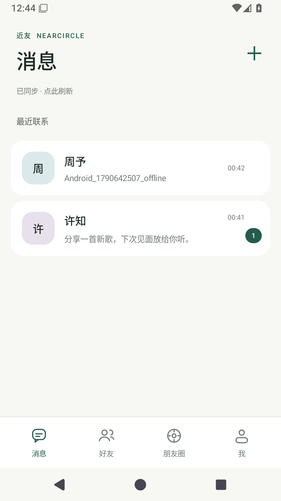
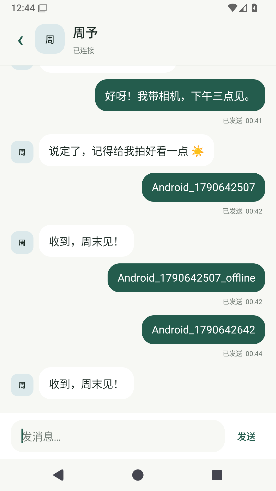
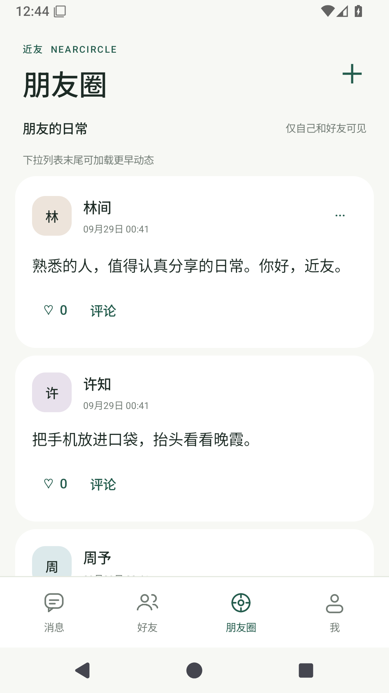

# 近友 · NearCircle

**一个用 Java 编写的原生 Android 熟人社交 App。** 好友申请、单聊、朋友圈与完整服务端，重点实现移动端断网队列、消息幂等、可靠补齐和访问权限。

这是面向学习、作品展示和面试讨论的单机工程项目，不宣称具备商业即时通信平台的规模、可用性或安全认证。

## 界面

以下图片来自运行中的 Android 15 模拟器。

| 消息 | 单聊 | 朋友圈 |
| --- | --- | --- |
|  |  |  |

## 已实现

- 注册、登录、编辑昵称与简介、退出登录；Android Keystore 加密保存会话。
- 搜索用户、申请好友、通过/忽略申请、双向好友列表。
- 一对一文本聊天、会话未读数量、本地记录、发送状态、失败重试。
- 消息先进入 Room，WorkManager 在联网后发送；进程重启后仍使用相同 `client_id`，服务端去重。
- WebSocket 通知更新，HTTP 游标分页补齐消息；断线不依赖广播重放。
- 好友可见的文字/单图朋友圈、点赞、评论、删除自己的动态、游标分页。
- 图片格式验证、像素/文件大小限制、去元数据重编码，读取图片也检查权限。

## 快速运行

需要 Android 8.0+ 设备，以及一台运行 Java 17 的电脑。手机和电脑位于同一局域网。

1. 从仓库 Releases 下载 Debug APK 和服务端 JAR。
2. 在 JAR 所在目录打开终端，运行：

```shell
java -jar NearCircle-server-1.0.0.jar --spring.profiles.active=demo
```

3. 安装 APK。在登录页向下滚动，设置服务地址：
   - Android 模拟器：`http://10.0.2.2:8080`
   - 真机：`http://电脑局域网IPv4:8080`，电脑需允许该端口的局域网访问。
4. 使用演示账号登录：`lin` / `zhou` / `xuzhi`，密码均为 `NearCircle2026!`。也可注册新账号。

演示账号仅在**显式 demo 模式且数据库为空**时创建。日常启动不加 demo 参数；数据库保存在运行目录的 `data/`。上传源码到 GitHub 不代表服务端已部署到公网。Debug APK 允许本地 HTTP；Release 配置只允许 HTTPS，且未提供用户自己的发布签名。

## 从源码构建

```shell
# 服务端：JDK 17 + Maven 3.9+
cd server
mvn test package
java -jar target/nearcircle-server-1.0.0.jar --spring.profiles.active=demo

# Android：JDK 17 + Android SDK 35
cd ../android
./gradlew testDebugUnitTest assembleDebug lintDebug
```

Windows 使用 `gradlew.bat`，或在项目根目录执行：

```powershell
./scripts/run-server.ps1 -Demo -Build
./scripts/android-build.ps1
```

Android Studio 打开 **android/**，服务端 IDE 打开 **server/pom.xml**。详情见 [构建环境](docs/tooling.md) 与 [服务端说明](server/README.md)。

## 工程结构

```text
android/app/src/main/java/io/github/lxy/nearcircle/
  data/       Room 消息、同步游标、会话、发件箱 Worker
  net/        OkHttp API、前台 WebSocket 连接
  ui/         原生界面、登录/发布 ViewModel、RecyclerView
server/       Spring Boot、JDBC、H2 持久化、WebSocket、集成测试
scripts/      构建、启动、真实 Android UI 冒烟测试
docs/         设计、验证、面试讲解和实际截图
```

客户端生产源码全部为 Java；构建脚本为 Gradle Groovy，自动化设备测试辅助脚本为 Python。服务端也是 Java。项目没有 WebView 套网页，也不依赖付费聊天 SDK。

## 值得研究的实现

| 问题 | 实现与验证方向 |
| --- | --- |
| 服务端已入库但回复丢失 | 持久化 `client_id` + 数据库唯一约束；相同请求返回同一消息，不同内容返回 409 |
| 发送回执先到，旧消息未同步 | **发送状态和同步游标分离**；仅完整 HTTP 页入库后推进游标 |
| 双向并发消息提交乱序 | 两端用户行按固定顺序加锁，保持同一会话 ID 与提交顺序一致 |
| 旧登录请求返回 401 | 比较原会话后原子退出；旧 Worker 不能改写新登录状态 |
| 动态加载中收到更新 | 合并刷新信号，当前请求完成后补一次；保留已加载页范围 |
| 阅读消息触发刷新循环 | 只有未读状态确实变化才发布通知 |
| 合法 JPEG 转 PNG 后膨胀 | 服务端缩放限制输出，客户端即使遇到无 Content-Length 响应也限流读取 |

进一步阅读：[架构与取舍](docs/architecture.md) · [验证记录](docs/validation.md) · [面试讲解与练习](docs/interview.md) · [API 契约](docs/design.md)。

## 当前边界

- 单实例 Spring Boot + H2 文件数据库，未验证横向扩展、高并发或长期在线运行。
- 没有群聊、语音视频、推送通知、端到端加密、手机号认证、找回密码、反垃圾和管理后台。
- WebSocket 仅前台运行；后台消息同步由系统调度，强行停止 App 后需要重新打开。聊天页离线可读本地记录，好友列表与朋友圈未做离线缓存。
- 密码及会话有保护，但本地聊天数据库未加密；图片可能保留在当前进程的内存缓存。请用测试内容演示。
- 发帖和评论不自动重试；若网络中断导致结果未知，界面提示先核对结果。消息发送有独立幂等保证，不能将其推广成所有写操作“恰好一次”。
- 未发布到应用商店。公开运营前需要补充治理、限流、监控、备份、隐私政策、依赖维护和部署安全。

**项目能证明什么取决于你能解释、修改和独立验证哪些部分。** 建议从断网补发实验开始，再学习会话隔离、事务和分页，避免把生成的代码直接当成自己的技术掌握程度。
