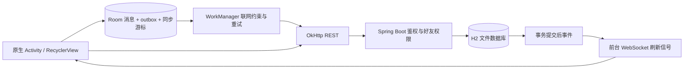

# 架构与关键取舍

## 一条消息的生命周期

1. 输入确认后分配 UUID，保存 owner（服务地址 + 用户 ID）、对端、正文和 `QUEUED` 状态。
2. WorkManager 唯一任务链使用 `APPEND_OR_REPLACE`。追加任务避免“最后一次空队列检查”和新消息入队之间的唤醒丢失。任务限制联网，瞬态失败指数退避；不同账号队列隔离。
3. Worker 捕获不可变 Session。HTTP 请求只使用该会话，服务端从 token 推导发送者。
4. 服务端在事务里检查好友关系，对两个用户按 ID 顺序加行锁，以 `(sender_id,client_id)` 唯一约束防重。同一 key 不同正文或收件人返回 409。
5. 回执校验 ID、发送者、收件人、client_id 和正文，再替换本地同一行。收到重复回执不会出现第二个气泡。
6. 刷新或回前台时从独立的 `sync_cursors` 开始 HTTP 翻页。消息和该页游标在同一个 Room 事务提交。

### 为什么不能把收到的最大 ID 当同步游标

假设对方发来 ID=100 的消息，本机没收到广播；自己发送成功得到 ID=101。若直接把游标设为 101，以后 `after_id=101` 就永远看不到 100。回执可以更新发送状态，却不能证明此前记录完整，因而两种状态必须分开。

### 为什么服务端还要控制提交顺序

数据库自增 ID 分配发生在事务提交之前。A->B 得到 ID=100 后事务尚未提交，B->A 得到 101 并先提交，此时分页能看到 101 却看不到 100。客户端推进游标后会漏消息。当前实现串行化共享端点的发送事务，代价是吞吐受限；这是单机项目中的可解释正确性取舍，不是大规模 IM 方案。未来可以引入独立会话序列和提交日志。

## 实时与后台

WebSocket 只发送刷新通知。单次 ticket 有效期 30 秒，握手消费后不可重用；连接失败指数重连。HTTP 与数据库保存完整事实，因此通知丢失不等于消息丢失。

前台聊天每 15 秒补齐，首页消息/好友页每 20 秒刷新作兜底。朋友圈将加载中的刷新请求合并到后续一次拉取，不启动永久后台 socket。WorkManager 由系统调度，不保证固定秒级送达。

## 会话与权限

- 密码 PBKDF2 + 随机盐；opaque token 只在服务端保存摘要，客户端由 Keystore AES-GCM 封装。
- 用户名/密码不写日志。个人资料公开搜索，聊天与朋友圈单独校验关系。
- token 注销与客户端 compare-and-clear 防止旧 401 清除新会话；Worker 错误入库也受原会话检查保护。
- 图片不挂到公共静态文件夹：所有者可读；好友仅可读取已发布动态引用的图片。删除引用后服务端拒绝好友读取。
- 账号切换隐藏其他账户本地消息；数据库本身不是加密数据库，不宣称保护已解锁设备上的取证访问。

## 可测试性与实际边界

网络层 JVM 使用真实 MockWebServer socket；Room、Keystore、Worker 和 Activity 状态在 Android 15 模拟器执行。服务端测试使用独立内存 H2，WebSocket 测试运行真实 HTTP 端口。两者与实际 App/演示服务的 UI 冒烟是三个不同层次，测试数量不等同于生产成熟度。

当前采用程序化原生布局，登录和发布有 ViewModel，消息由 Room LiveData 驱动。首页复杂渲染仍集中在 MainActivity；后续可按功能拆为 Fragment/独立 presenter，而不是宣称已实现完整严格分层 MVVM。
